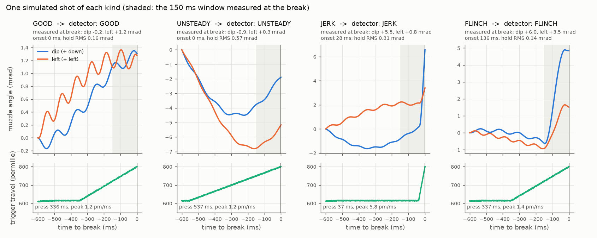
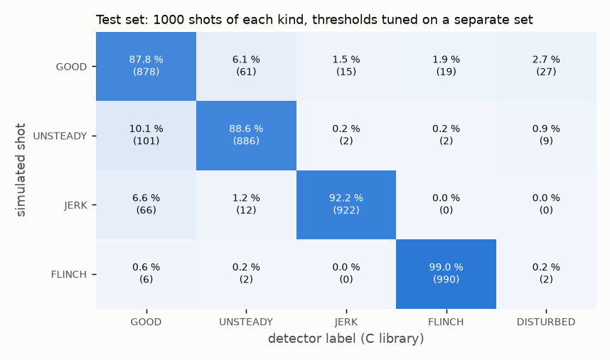
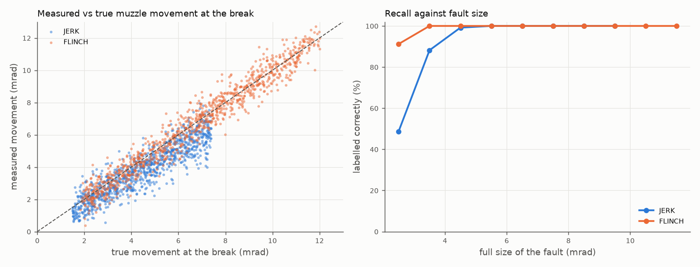

# Trigger-control analysis for a training weapon (prototype)

[](https://github.com/chad416/trigger-control-analysis/actions/workflows/ci.yml)

A per-shot fault detector for an instrumented training weapon, in C, running on signals the weapon already has: the IMU and the analog trigger. For each shot it looks at the half second before the trigger breaks and reports:

- whether the muzzle moved at the break, by how much and which way;
- when that movement started;
- how the final press went;
- a label: **GOOD**, **UNSTEADY** (shaky hold, clean break), **JERK** (snatched trigger dragging the muzzle) or **FLINCH** (muzzle pushed down in anticipation of recoil). Shots that moved but fit neither pattern are labelled **DISTURBED**.

An instructor sees a jerk or a flinch only as a bad hit. This tells them, shot by shot, which of the two it was.

It is a prototype for a thesis topic and builds on [trainer-weapon-firmware-twin](https://github.com/chad416/trainer-weapon-firmware-twin). That firmware already keeps a 500 ms IMU ring buffer (LSM6DSO, 208 Hz), a 1 kHz trigger-travel signal and three simple pre-shot numbers (SPEC F10). This library uses the same weapon frame, sample types and rectangle-rule integration.

**Everything here runs on simulated shots.** No real shooter data has been recorded yet. See [Limits](#limits).



## Results (test set, never used for tuning)

4000 simulated shots, 1000 of each kind. The thresholds were tuned on a separate 2000-shot set generated from a different seed.

| | GOOD | UNSTEADY | JERK | FLINCH |
|---|---|---|---|---|
| Recall | 87.8 % | 88.6 % | 92.2 % | 99.0 % |
| Precision | 83.5 % | 92.2 % | 98.2 % | 97.9 % |

- **Overall:** balanced accuracy 91.9 % on the test set, 92.4 % on the training set.
- **Size of the movement at the break:** RMS error against the injected fault is 1.18 mrad for jerks (median true size 4.5 mrad) and 0.88 mrad for flinches (median 6.8 mrad).
- **Flinch onset:** reported a median 8 ms later than the true start; 90 % of shots fall within 3–33 ms late. The movement only stands out once it is under way.
- **C against the NumPy reference:** all 4000 labels agree, and the largest numeric difference is 3×10⁻⁶ mrad.
- **Size on the MCU:** 2.45 kB of code (gcc -O2, x86-64), no static RAM, no heap. It runs once per shot from buffers the firmware already holds.
- **Tests:** 40 C unit-test checks on hand-built signals with known answers, and 4 pytest cross-checks.





What the plots show:
- **Small jerks are the weak spot.** Faults under 3 mrad are found about half the time; from 4 mrad up, almost all are found.
- **Large jerks are under-measured.** A jerk happens in the last 10–35 ms, and at 208 Hz that is only two to seven IMU samples, the last of which covers the break itself. Running the same IMU at 833 Hz is the obvious next test.
- **The common confusion is GOOD versus UNSTEADY,** where the hold sway sits near the threshold.

## How it works

`trgctl/trgctl.c`, one function, `trgctl_analyze()`:

1. **Reference rate.** Fit a straight line to the gyro rate 160–320 ms before the break and extrapolate it to the break. This follows the slow hold sway and the gyro bias together.
2. **Movement at the break.** Integrate the rate minus that reference over the last 150 ms. The result is the dip and left angle in mrad.
3. **Onset.** Find the oldest sample in that window whose residual rate exceeds 4× the residual spread in the reference window (at least 0.3 °/s, and at least two such samples).
4. **Hold steadiness.** Take the RMS of the angle with the mean rate removed, 200–600 ms before the break.
5. **Trigger.** Measure the time from the travel last being below 620 ‰ to the break, and the fastest 5 ms travel rate in the last 50 ms.
6. **Decision.**
   - A small movement (under 1.5 mrad, or under 6× the hold RMS if that is larger) gives GOOD, or UNSTEADY if the hold RMS is above 0.3 mrad.
   - Otherwise, a fast press (2.5 ‰/ms or more) or a late onset (25 ms or less) gives JERK.
   - Otherwise, a movement that is mostly downward gives FLINCH.
   - Anything else gives DISTURBED.

The thresholds come from a grid search over the training set (`tools/evaluate.py --tune`). They were taken from the flat top of the score (92.4 %) rather than the single best cell (92.55 %), which sat at the edge of the grid.

The simulator, `sim/shooter_sim.py`, generates:
- **Hold sway:** 0.2–1 Hz with an 8–12 Hz tremor.
- **Faults:**
  - jerk: 2–10 mrad, down and left, starting 10–35 ms before the break, with a 8–40 ms final press;
  - flinch: 2–12 mrad, down, starting 50–150 ms before the break, with a forward push on the accelerometer.
- **Some clean but fast presses** among the GOOD shots, so the trigger alone is not enough.
- **LSM6DSO-class sensor noise:** 3.8 mdps/√Hz, ±0.5 °/s bias, 8.75 mdps/LSB.

## Limits

- **Simulated shooters.** The sway model, fault sizes, directions and timings are assumptions that look plausible, not measurements. The accuracy figures say the method separates *these* models; they say nothing yet about real people.
- **Tuned on the simulator.** Real thresholds will differ, and probably differ per shooter.
- **One weapon frame.** The IMU sits on the weapon, the shooter is right-handed and the cant is small. Recoil after the break is not modelled: the detector uses only data from before the break.
- **Not the first in the field.** Commercial shot-trainer sensors already score trigger control from a rail-mounted IMU (for example Mantis X), and patents describe monitoring pre-break motion (US 10,712,116; US 11,788,813). What is different here:
  - it runs inside the training weapon's own firmware;
  - it uses the analog trigger trace together with the IMU;
  - it could be checked against the lane camera's aim trace ([aim-point-tracker](https://github.com/chad416/aim-point-tracker)).

## Open questions for a thesis

1. **Validation on real shooters.** Record shooters with a coach labelling each shot, measure accuracy against those labels, and compare with the simulator.
2. **IMU rate.** Does 833 Hz fix the under-measured jerks, and at what cost in power?
3. **Camera fusion.** Does the camera's aim trace around the break confirm the IMU's movement, so each shot gets an explanation: "missed 12 mm low-left, trigger jerk"?
4. **Per-shooter adaptation.** Set thresholds from each shooter's first dry-fire shots.
5. **Showing it to the instructor:** in a form a coach can act on during a session.

## Run it

Ubuntu 24.04, natively or in WSL2, with gcc and Python 3.10+:

```bash
pip install -r requirements.txt
./scripts/build.sh       # C library, C unit tests
./scripts/evaluate.sh    # build + pytest + evaluation; writes results/
python3 tools/evaluate.py --tune   # threshold search on the training set
```

## Layout

```
trgctl/              C library (trgctl.h, trgctl.c)
tests/test_trgctl.c  C unit tests
tests/test_crosscheck.py  C against the reference, simulator sanity
ref/trgctl_ref.py    NumPy reference of the same algorithm
sim/shooter_sim.py   simulated shots: motion, IMU, trigger
tools/evaluate.py    tuning, evaluation, plots
tools/trgctl_c.py    ctypes wrapper for the C library
results/             eval.json and the plots above
```

MIT licence.
